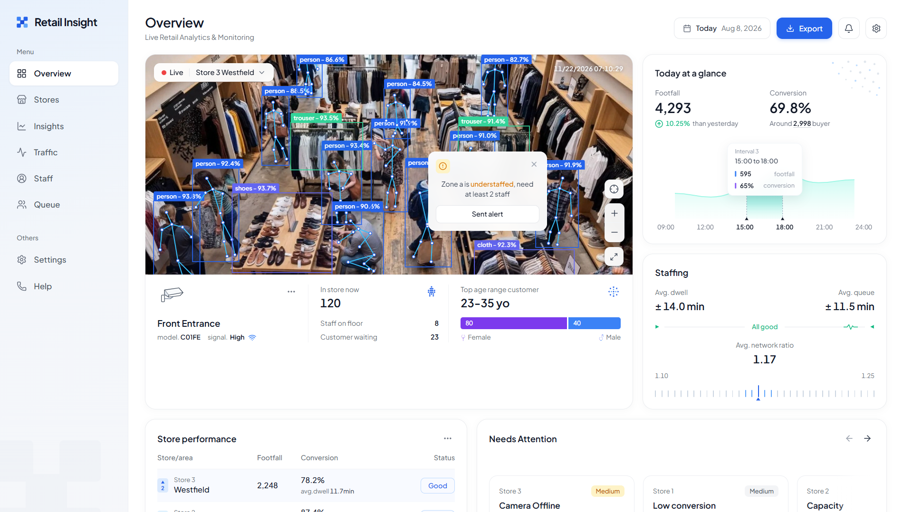
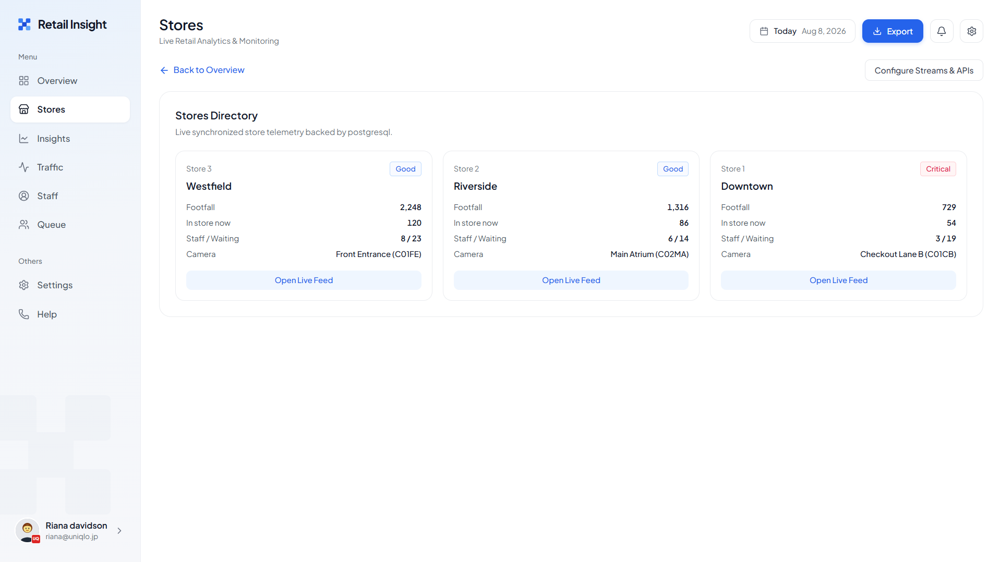
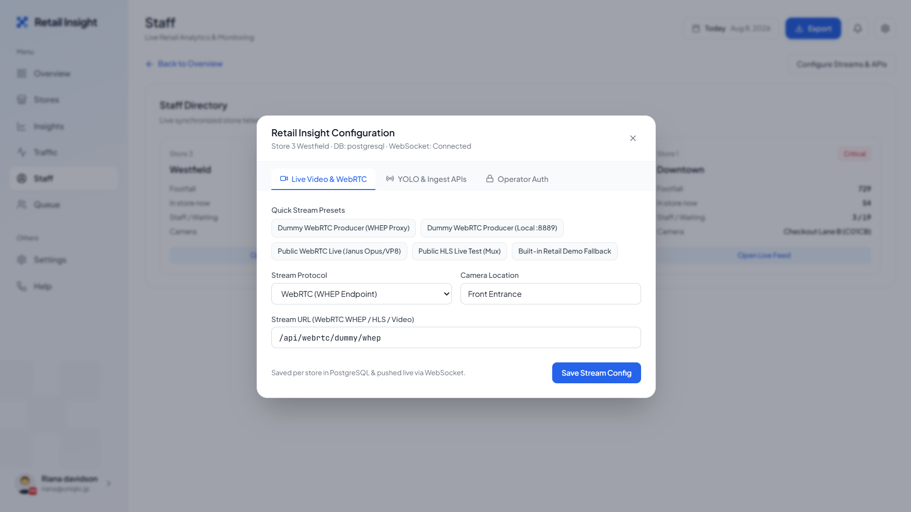
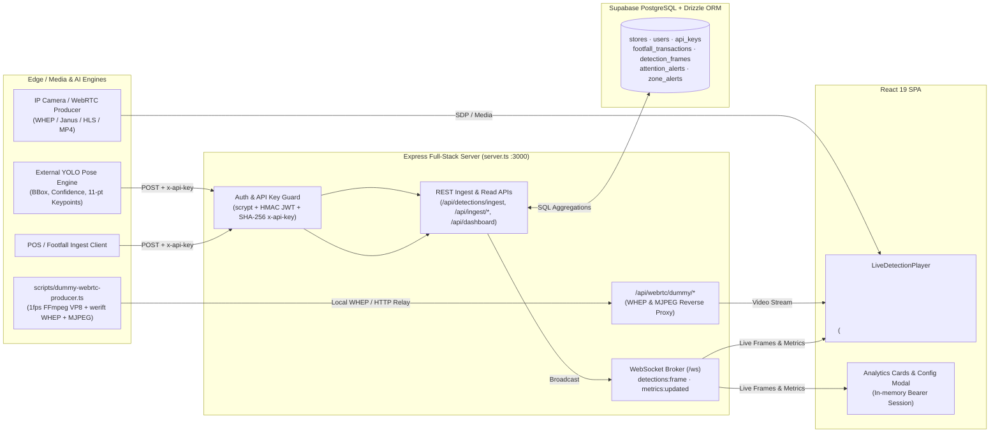

<div align="center">

# Retail Insight

**Live Retail Analytics, WebRTC Video Monitoring & Real-Time YOLO Pose Detection Platform**

<p>
  
  
  
  
  
  
  
  
</p>

</div>

---

## Preview

<p>
  
</p>

<table>
  <tr>
    <td width="50%">
      
    </td>
    <td width="50%">
      
    </td>
  </tr>
</table>

---

## Project Structure

```text
retail-insight/
├── docs/                                # Documentation & README preview screenshots
│   ├── screen_retail_insight_main.png
│   ├── screen_retail_insight_stores.png
│   └── screen_retail_insight_config.png
├── scripts/                             # Standalone telemetry & WebRTC dev producers
│   ├── dummy-webrtc-producer.ts         # 1fps FFmpeg VP8 -> werift WHEP + MJPEG relay + YOLO pose ingestor
│   └── inject-dummy-data.ts             # API-only sample transaction, metrics & detection seeder
├── src/
│   ├── components/                      # Modular UI components
│   │   ├── ConfigAndAuthModal.tsx       # Stream protocol config, API key manager & operator auth modal
│   │   ├── LiveDetectionPlayer.tsx      # WebRTC WHEP / Janus / HLS / MP4 player + Canvas 2D YOLO overlay
│   │   ├── NeedsAttentionCard.tsx       # Store alert carousel with dispatch acknowledgement
│   │   ├── SecondaryViewPanel.tsx       # Directory & documentation views for sidebar routes
│   │   ├── Sidebar.tsx                  # Primary navigation & operator session switcher
│   │   ├── StaffingCard.tsx             # Dwell/queue SLA metrics & network ratio gauge
│   │   ├── StorePerformanceCard.tsx     # Real-time SQL-aggregated store comparison table
│   │   └── TodayAtGlanceCard.tsx        # Daily footfall, conversion KPIs & interactive interval chart
│   ├── db/
│   │   ├── drizzle.config.ts            # Drizzle Kit PostgreSQL config (split DB env parameters)
│   │   ├── repository.ts                # PostgreSQL SQL aggregations, transactions & detection persistence
│   │   └── schema.ts                    # Drizzle relational table definitions
│   ├── hooks/
│   │   └── useRetailSocket.ts           # Auto-reconnecting WebSocket client for detections & metrics
│   ├── server/
│   │   └── auth.ts                      # scrypt password hashing, HMAC-SHA256 JWT & SHA-256 API key auth
│   ├── types/
│   │   └── retail.ts                    # Shared TypeScript contracts across backend & UI
│   ├── App.tsx                          # Dashboard shell, state synchronization & route views
│   ├── index.css                        # Tailwind CSS v4 entry & typography tokens
│   └── main.tsx                         # React 19 mount entry
├── server.ts                            # Express HTTP API, WebSocket broker, WHEP proxy & Vite middleware
├── .env.example                         # Environment variable template (no hardcoded secrets)
├── index.html                           # HTML entry point & Google Fonts
├── metadata.json                        # App manifest metadata
├── package.json                         # Scripts & dependency manifest
├── tsconfig.json                        # TypeScript compiler configuration
└── vite.config.ts                       # Vite bundler & Tailwind plugin configuration
```

---

## Application & System Architecture



### Core Data Flows

1. **Live Video Plane (`WebRTC WHEP / Janus / HLS / MP4`)**:
   - Stores persist their active `streamType` and `streamUrl` in PostgreSQL.
   - `LiveDetectionPlayer.tsx` negotiates WebRTC WHEP (`POST` SDP offer/answer), public Janus WebRTC long-polling, HLS (`hls.js`), or direct video playback.
   - For local/containerized debugging behind strict UDP firewalls, `scripts/dummy-webrtc-producer.ts` encodes a 1fps VP8 stream via FFmpeg into `werift` WHEP (`:8889`) and exposes an HTTP MJPEG relay proxied seamlessly under `/api/webrtc/dummy/*`.

2. **Decoupled AI Detection & Telemetry Ingestion**:
   - Inference engines run externally and push normalized or pixel-coordinate bounding boxes, class labels, confidence scores, and human pose keypoints to `POST /api/detections/ingest`.
   - Footfall, conversions, dwell/queue times, demographics, and alerts enter through `/api/ingest/transactions`, `/api/ingest/metrics`, and `/api/ingest/alerts`.
   - All ingestion routes require a valid `x-api-key` (verified against `INGEST_API_KEY` or SHA-256 hashes in `api_keys`).

3. **Real-Time SQL Aggregation & WebSocket Broadcast**:
   - Dashboard KPIs (`Today at a glance`, `Store performance`, `Staffing` dwell/queue/network ratio) are computed directly from SQL aggregations over `footfall_transactions` and `stores`.
   - Incoming detections and metric updates immediately fan out over `/ws` to subscribed store clients, rendering pixel-aligned bounding boxes and pose skeletons directly on an overlaid Canvas 2D layer.

---

## Tech Stack

| Layer | Technologies |
| :--- | :--- |
| **Frontend** | React 19, TypeScript, Vite 8, Tailwind CSS v4, Lucide Icons, Motion |
| **Video & Canvas** | WebRTC (`RTCPeerConnection` / WHEP), `hls.js`, HTML5 `<video>`, Canvas 2D Overlay |
| **Backend** | Node.js, Express 4, `ws` (WebSocket Server), Zod validation, `tsx` |
| **Dummy Producer** | `werift` (Pure TypeScript WebRTC SFU/WHEP), FFmpeg (`libvpx` VP8 + MJPEG) |
| **Database & ORM** | PostgreSQL (Supabase Pooler), Drizzle ORM, `pg` (`node-postgres`), Drizzle Kit |
| **Security** | `crypto.scryptSync` password hashing, HMAC-SHA256 JWT, `timingSafeEqual` API key verification |

---

## How to Build & Run

### 1. Prerequisites

- **Node.js** `>= 20` and **npm**
- **FFmpeg** installed on `PATH` (required only if running `scripts/dummy-webrtc-producer.ts`)
- A **PostgreSQL** / **Supabase** database instance (optional fallback runs in-memory if DB credentials are omitted)

### 2. Configure Environment Variables

Copy `.env.example` to `.env` and fill in your split PostgreSQL connection parameters and keys:

```bash
cp .env.example .env
```

```env
PORT=3000

# PostgreSQL / Supabase connection parameters (split config)
DB_HOST=your-postgres-host
DB_PORT=5432
DB_NAME=postgres
DB_USER=your-postgres-user
DB_PASSWORD=your-postgres-password
DB_SSL=true

# Shared API key for external YOLO & telemetry ingestion
INGEST_API_KEY=replace_with_strong_random_secret

# Optional operator passcode & JWT signing secret
ADMIN_PASSCODE=replace_with_admin_passcode
JWT_SECRET=replace_with_at_least_32_char_secret
```

### 3. Install Dependencies

```bash
npm install
```

### 4. Run in Development Mode

```bash
npm run dev
```

This starts the unified Express + Vite middleware server on `http://localhost:3000`, exposes `/ws`, initializes database tables automatically, and spawns `scripts/dummy-webrtc-producer.ts` (1fps WebRTC + YOLO detection injector).

To run the dummy producer or data injector manually instead:

```bash
# Disable auto-spawn on server boot if running producer separately
AUTO_START_DUMMY_PRODUCER=false npm run dev

# In another terminal:
npm run producer:dummy -- --api-key=YOUR_API_KEY --seed-metrics
# or seed transactions/metrics once:
npm run inject:demo -- --api-key=YOUR_API_KEY --loop
```

### 5. Typecheck & Production Build

```bash
npm run lint    # Runs tsc --noEmit
npm run build   # Builds optimized React SPA into dist/
```

Run the compiled production server locally:

```bash
NODE_ENV=production npm start
```

---

## How to Deploy

Because **Retail Insight** serves the REST API, WebSocket broker, WHEP proxy, and static SPA (`dist/`) from a single Node.js entry point (`server.ts`), it deploys cleanly to any container platform (**Google Cloud Run**, **Docker**, **Railway**, **Fly.io**, or **VPS**).

### Standard Container / Cloud Run Steps

1. **Build step**:
   ```bash
   npm ci
   npm run build
   ```
2. **Start command**:
   ```bash
   NODE_ENV=production npm start
   ```
   *(Configured in `package.json` as `"start": "node server.ts"` on Node `>= 22.6` / `tsx`, listening on `0.0.0.0:$PORT`, default `3000`.)*
3. **Production Environment Configuration**:
   - Set `DB_HOST`, `DB_PORT`, `DB_NAME`, `DB_USER`, `DB_PASSWORD`, `DB_SSL=true` in your cloud secret manager.
   - Set a persistent `JWT_SECRET` (`>= 32` chars) so operator login sessions survive container restarts.
   - Set `INGEST_API_KEY` or create scoped engine keys via **Settings → YOLO & Ingest APIs** after signing in.
   - Set `AUTO_START_DUMMY_PRODUCER=false` in production when connecting real store camera streams (`WHEP` / `HLS` / `MP4`) and an external GPU YOLO inference service; install `ffmpeg` in your container image only if keeping the built-in dummy producer enabled.
4. **Verify Health & Live Endpoints**:
   - Dashboard UI: `GET /`
   - Aggregated telemetry: `GET /api/dashboard?storeId=3`
   - WebSocket stream: `wss://<your-domain>/ws?storeId=3`
   - YOLO ingestion: `POST /api/detections/ingest` (`x-api-key` header)
